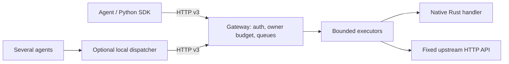

# AI Protocol


[](https://github.com/Xenox-developer/ai-protocol/actions/workflows/checks.yml)
[](LICENSE)

A Rust framework and Python SDK for cooperative agent access to HTTP services.

[Quickstart](#try-it-locally) · [Rust integration](#add-a-service-in-rust) ·
[Python SDK](#call-it-from-python) · [Protocol](docs/protocol.md)

Use it when several agents need to share access to one service. The service
owner publishes permitted read operations and sets a shared workload budget.
For example, three agents belonging to the same owner can share a limit of five
accepted requests across their tokens and connections. Queued and running work
both count toward that limit; it is not a spending or LLM token budget.

**Status:** experimental 0.1.0, with read-only operations and one in-memory gateway
process per service. AI Protocol is a project contract, not a public standard.
The optional local dispatcher requires Linux or macOS.

## What it provides

- **Rust gateway:** embed typed async handlers in Axum or connect an existing
  HTTP API through a service manifest.
- **Shared access controls:** enforce operation permissions and one workload
  budget per owner and scheduling class across clients.
- **Bounded work:** limit queues, execution slots, waiting time and response size.
- **Adaptive Python SDK:** discover operations, refresh capacity limits and apply
  conservative retries within one task deadline. OpenAI is optional.
- **Optional local dispatcher:** coordinate several agent processes through one
  Unix socket per service/owner.

## How requests flow



The service owner configures operations, credentials and budgets. Agent developers
discover and call permitted operations. Owners of several agents can add the
dispatcher; the gateway remains responsible for admitting requests.

## Installation

Version 0.1.0 is not yet published to crates.io or PyPI. Use a source checkout
for the local demo and development, or download the verified artifacts from
[GitHub Releases](https://github.com/Xenox-developer/ai-protocol/releases/tag/v0.1.0).
That page tracks registry publication status.

### Try it locally

Prerequisites: Rust/Cargo **1.98.1** (pinned), Python **3.12+**, Git, and Linux or
macOS. A C/C++ build toolchain and CMake are needed for native dependencies; see
[platform setup](docs/QUICKSTART.md#1-tools-and-dependencies). Clone the repository,
then run the remaining commands inside it:

```sh
git clone https://github.com/Xenox-developer/ai-protocol.git
cd ai-protocol
python3 -m venv .venv
source .venv/bin/activate
python -m pip install -e .
cargo build --locked --bins
python examples/quickstart.py
```

Expected result: a successful catalog call, three independent clients through a
shared dispatcher, final `outstanding=0`, then cleanup of owned processes and
temporary credentials. The script uses free loopback ports and local fixture
data. No paid API or LLM is required. See the [quickstart](docs/QUICKSTART.md) for
roles, troubleshooting and the manual workflow.

### Use release artifacts

Download the wheel, `ai-protocol-0.1.0.crate` and `SHA256SUMS` from the release
page. From the download directory, verify the hashes of the files you downloaded
against `SHA256SUMS`, then install the SDK:

```sh
python3 -m venv .venv
source .venv/bin/activate
python -m pip install ./ai_protocol_client-0.1.0-py3-none-any.whl
```

For Rust integration, extract the `.crate` archive and use the extracted directory
as a Cargo path dependency. Release artifacts do not contain the full demo
checkout; use the source recipe above to run `examples/quickstart.py`.

## Add a service in Rust

For source integration, add this checkout as a path dependency in your application:

```toml
[dependencies]
ai-protocol = { path = "../ai-protocol" }
```

Register read-only handlers with `Operation::new` and give callers `Credential`
grants. This function embeds those operations in an Axum server:

```rust
use ai_protocol::{Credential, Gateway, GatewayConfig, Operation};

async fn serve_documents(
    operations: Vec<Operation>,
    credentials: Vec<Credential>,
) -> Result<(), Box<dyn std::error::Error>> {
    let config = GatewayConfig::native("documents", operations, credentials)?;
    let gateway = Gateway::start(config).await?;
    let app = axum::Router::new().merge(gateway.router());
    let listener = tokio::net::TcpListener::bind("127.0.0.1:3000").await?;
    axum::serve(listener, app)
        .with_graceful_shutdown(async {
            let _ = tokio::signal::ctrl_c().await;
        })
        .await?;
    gateway.shutdown().await?;
    Ok(())
}
```

The host owns the listener and keeps the gateway alive while serving requests.
See [Rust integration](docs/rust-library.md#use-from-a-separate-application) for
the application's dependencies and lifecycle details.

A complete runnable integration is [native_service.rs](examples/native_service.rs):

```sh
export NATIVE_AGENT_TOKEN="$(python3 -c 'import secrets; print(secrets.token_urlsafe(24))')"
cargo run --locked --example native_service
```

Handlers must be nonblocking and read-only. Keep each discovery schema consistent
with its Serde input type and application validation. For an existing HTTP API,
use a [service manifest](docs/service-integration.md).

## Call it from Python

Install the SDK using either recipe above. The distribution is
`ai-protocol-client`; the import is `ai_protocol`. With the native Rust example
running, open another terminal, activate your SDK environment and set
`SERVICE_URL=http://127.0.0.1:3000` and `AGENT_TOKEN_1` to that server's
`NATIVE_AGENT_TOKEN` value. Keep the credential private.

Use a separate client per service/credential and share it across concurrent tasks:

```python
import asyncio
import os
from ai_protocol import AsyncClient, OperationError

async def main():
    async with AsyncClient(
        os.environ["SERVICE_URL"], os.environ["AGENT_TOKEN_1"]
    ) as client:
        print([op["name"] for op in client.policy["operations"]])
        try:
            result = await client.call("find_documents", {"query": "rust"}, timeout=10)
            print(result)
        except OperationError as error:
            print(error.code, error.execution)

asyncio.run(main())
```

The example prints `{'documents': ['Rust introduction']}`. Operation names and
parameters come from discovery. See [Python SDK](docs/python-sdk.md) for policy
refresh, deadlines, errors and retry rules. Unknown outcomes are terminal;
cancelling a client call does not prove downstream work stopped.

The checkout also includes `examples/sdk_client.py`, an interactive generic
client. For the optional LLM example, install `python -m pip install -e '.[llm]'`
from the checkout; real model calls require your own API access.

## Configuration and guarantees

The executable binds to loopback by default. Configure the listener, executors,
queues, timeouts, body bounds and credentials using the [configuration and
operations guide](docs/operations.md). Public HTTPS uses a reverse proxy; that
guide includes a Caddy recipe, health/readiness routes, private admin metrics,
logging and shutdown behavior.

Budgets cover accepted queued and running work in **one process**, separately
for each owner and scheduling class. Reducing a limit does not cancel accepted
jobs. Timeouts do not prove that remote work stopped; there is no exactly-once or
durable recovery guarantee. Scheduling and execution-certainty rules are in
[protocol v3](docs/protocol.md).

This release does not provide replica coordination, durable queues, writes,
Windows dispatcher support, automatic API import, a UI, per-owner CPU isolation
or an independent security audit. See [compatibility and schemas](docs/compatibility.md)
and [security](SECURITY.md).

## Develop and verify

From a source checkout with its virtual environment active:

```sh
python -m pip install -r requirements.txt
bash scripts/verify.sh
# Build verified, unpublished crate/sdist/wheel files into a new local directory:
python scripts/check_packages.py --output dist/local-release
```

The verification command checks formatting, all Rust targets/tests/docs, Python
tests, an external Rust application, HTTP demos, documentation links, and isolated
artifact installation. CI runs it on Ubuntu and macOS. Packaging excludes raw
benchmark data, virtual environments and local credentials. The wheel is built
from the source distribution and tested without OpenAI outside the checkout.
See [contributing](CONTRIBUTING.md), the [release procedure](docs/releasing.md),
and the [framework verification report](docs/FRAMEWORK_REPORT.md).

Historical measurements and their limitations are documented in the
[benchmark overview](benchmarks/README.md) and [framework report](docs/FRAMEWORK_REPORT.md).

## Community and license

Use [GitHub issues](https://github.com/Xenox-developer/ai-protocol/issues) for bugs
and proposals, following [contribution guidance](CONTRIBUTING.md) and the
[code of conduct](CODE_OF_CONDUCT.md). Report vulnerabilities through the private
route in [SECURITY.md](SECURITY.md). Changes are recorded in [CHANGELOG.md](CHANGELOG.md).
Licensed under [Apache-2.0](LICENSE).
