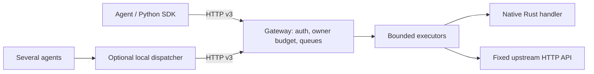

# AI Protocol

[](https://github.com/Xenox-developer/ai-protocol/actions/workflows/checks.yml)
[](LICENSE)

A Rust framework and Python SDK for cooperative agent access to HTTP services.
Publish permitted read operations, enforce shared owner budgets, and let clients
adapt to changing capacity through protocol v3 discovery.

**Status:** experimental 0.1.0. The [release page](https://github.com/Xenox-developer/ai-protocol/releases/tag/v0.1.0)
provides verified archives and the current crates.io/PyPI publication status.
AI Protocol is a project contract, not a public standard. Supported scope is one in-memory gateway process per
service, read-only operations, and Linux/macOS for the optional dispatcher.

## What it provides

- **Embeddable Rust gateway:** typed asynchronous native handlers in Axum, or
  an owner-configured HTTP adapter. Native inputs can contain nested objects,
  arrays, booleans and optional fields; the HTTP mapper supports flat required
  strings/integers mapped from POST JSON to GET query parameters.
- **Server-enforced access and budgets:** operation grants and one outstanding
  counter per owner/class, shared across tokens, connections and clients.
- **Bounded scheduling:** queues and execution slots, FIFO within each class,
  interactive/agent selection weights of 3:1 under competition, queue expiry,
  execution deadlines and bounded buffered responses.
- **Adaptive Python SDK:** full policy refresh, a local attempt gate, typed
  failures, one task deadline and bounded safe retries. OpenAI is optional.
- **Optional local dispatcher:** coordinate several agent processes through one
  Unix socket per service/owner, without replaying unknown results.
- **Operational controls:** host authentication callback, separate upstream/admin
  credentials, graceful shutdown, probes, basic metrics and safe JSON logs.

## Try it locally

Prerequisites: Rust/Cargo **1.98.1** (the pinned and tested minimum), Python
**3.12+**, and Linux or macOS. Run these commands from the repository root:

```sh
git clone https://github.com/Xenox-developer/ai-protocol.git
cd ai-protocol
python3 -m venv .venv
source .venv/bin/activate
python -m pip install -e .
cargo build --locked --bins
python examples/quickstart.py
```

Expected result: a successful catalog call, three independent clients through a
shared dispatcher, final `outstanding=0`, then cleanup of owned processes and
temporary credentials. The script uses free loopback ports and local fixture
data. No paid API or LLM is required. See the [quickstart](docs/QUICKSTART.md) for
roles, troubleshooting and the manual workflow.

For a persistent catalog demo, run `python examples/setup_demo.py` once, start
`python examples/catalog_service.py` in one terminal, then `source .env.demo`
and `cargo run --locked --bin ai-protocol` in another. The generated credential
file is private, ignored by Git, and never overwritten. Give each deployed agent
only its own credential.

## Add a service in Rust

For source integration, add this checkout as a path dependency in your application:

```toml
[dependencies]
ai-protocol = { path = "../ai-protocol" }
```

Register an `Operation::new` with its name, description, POST path, JSON input
schema and typed async handler. Create `GatewayConfig::native` with credentials,
start a `Gateway`, and merge `gateway.router()` at the root of your Axum router.
The host owns the listener and keeps the gateway alive while serving requests.
Call `close()` and `shutdown()` as part of bounded server shutdown.

A complete runnable integration is [native_service.rs](examples/native_service.rs):

```sh
export NATIVE_AGENT_TOKEN="$(python3 -c 'import secrets; print(secrets.token_urlsafe(24))')"
cargo run --locked --example native_service
```

Native inputs use Serde validation before admission; the service owner keeps the
published schema consistent with that Rust type and validates extra constraints.
Handlers must be nonblocking and read-only. For an existing HTTP API, use a
[service manifest](docs/service-integration.md); the included catalog and support
services demonstrate the same generic clients without service-specific branches.
See [Rust integration](docs/rust-library.md) for public interfaces, live host
authentication, resource bounds, budget updates and lifecycle semantics.

## Call it from Python

Install with `python -m pip install -e .` from the checkout, or install a verified
release wheel. The distribution is `ai-protocol-client`; the import is `ai_protocol`.
Use a separate client per service/credential and share it across concurrent tasks:

```python
import asyncio
import os
from ai_protocol import AsyncClient, OperationError

async def main():
    async with AsyncClient(
        os.environ["SERVICE_URL"], os.environ["AGENT_TOKEN_1"]
    ) as client:
        print([op["name"] for op in client.policy["operations"]])
        try:
            result = await client.call("find_documents", {"query": "rust"}, timeout=10)
            print(result)
        except OperationError as error:
            print(error.code, error.execution)

asyncio.run(main())
```

For the Rust example above, set `SERVICE_URL=http://127.0.0.1:3000` and give the
client its `NATIVE_AGENT_TOKEN` value as `AGENT_TOKEN_1`. Operation names and
parameters come from discovery. Policy failures pause new attempts; shrinking a
limit preserves attempts already running. Only admission 429 and the documented
pre-execution queue timeout may be retried, at most five attempts under the same
deadline. Unknown outcomes are terminal. Cancellation propagates to the caller
and does not prove downstream work stopped.

See [Python SDK](docs/python-sdk.md) for deadlines, errors, legacy synchronous
helpers and the dispatcher connector. `examples/sdk_client.py` provides an
interactive generic client. An LLM example is available after
`python -m pip install -e '.[llm]'`; real model calls require your own API access.

## How requests flow



The service owner defines operations, trusted classes, permissions and budgets.
Agent developers discover/call permitted operations. Owners of several agents
can add the shared dispatcher; the gateway remains the admission authority.

## Configuration and guarantees

The executable binds to loopback by default. Configure the listener, executors,
queues, timeouts, body bounds and credentials using the [configuration and
operations guide](docs/operations.md). Public HTTPS uses a reverse proxy; that
guide includes a Caddy recipe, health/readiness routes, private admin metrics,
logging and shutdown behavior.

Budget accounting covers accepted queued and running work in **one process**.
Reducing a limit does not cancel accepted jobs. The 3:1 rule concerns selection,
not completion order or latency. Local timeout/drop cannot establish that a
remote operation did not execute. Errors carry explicit execution certainty;
there is no exactly-once or durable recovery guarantee.

This release does not provide replica coordination, durable queues, writes,
Windows dispatcher support, automatic API import, a UI, per-owner CPU isolation
or an independent security audit. See [protocol v3](docs/protocol.md),
[compatibility and schemas](docs/compatibility.md), and [security](SECURITY.md).

## Develop and verify

```sh
python -m pip install -r requirements.txt
bash scripts/verify.sh
# Build verified, unpublished crate/sdist/wheel files into a new local directory:
python scripts/check_packages.py --output dist/local-release
```

The verification command checks formatting, all Rust targets/tests/docs, Python
tests, an external Rust application, HTTP demos, documentation links, and isolated
artifact installation. CI runs it on Ubuntu and macOS. Packaging excludes raw
benchmark data, virtual environments and local credentials. The wheel is built
from the source distribution and tested without OpenAI outside the checkout.
See [contributing](CONTRIBUTING.md), the [release procedure](docs/releasing.md),
and the [framework verification report](docs/FRAMEWORK_REPORT.md).

Historical measurements are reproducible experiments with workload-specific
limits, not performance promises: [benchmark overview](benchmarks/README.md),
[second-service report](integration/SECOND_SERVICE_REPORT.md), and the
[historical catalog runbook](docs/history/README-before-framework.md). New framework
changes have functional checks; the full historical load series was not rerun.
The external developer trial remains skipped; no independent usability evidence
is claimed.

## Community and license

Use [GitHub issues](https://github.com/Xenox-developer/ai-protocol/issues) for bugs
and proposals, following [contribution guidance](CONTRIBUTING.md) and the
[code of conduct](CODE_OF_CONDUCT.md). Report vulnerabilities through the private
route in [SECURITY.md](SECURITY.md). Changes are recorded in [CHANGELOG.md](CHANGELOG.md).
Licensed under [Apache-2.0](LICENSE).
